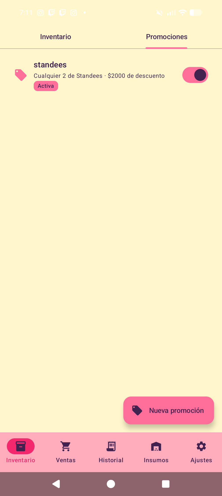
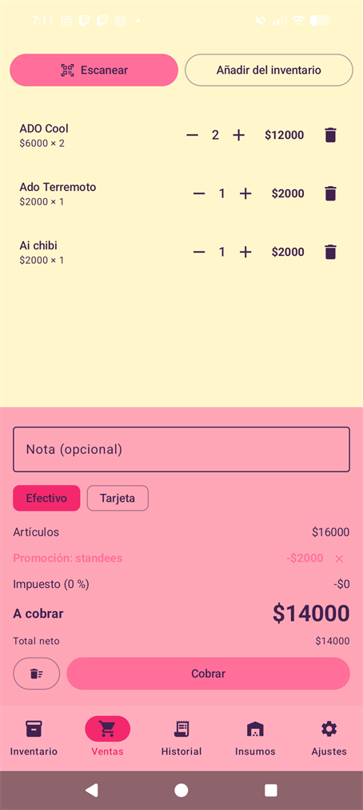
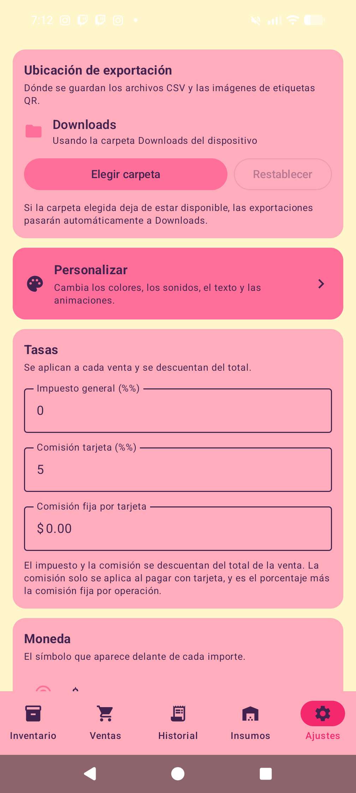

**Support me on Ko-fi:** [](https://ko-fi.com/krisoll)

**Follow me on Socials:** [](https://www.instagram.com/krisoll/) [](https://x.com/krisoll) 

**Try it on desktop with the companion:** [krisoll.github.io/Crummy-Stock-Web](https://krisoll.github.io/Crummy-Stock-Web/) 

**Join the community:** [](https://discord.gg/schG4aJ24T)

# Crummy Stock — Android

[](https://github.com/krisoll/Crummy-Stock/actions/workflows/ci.yml)
[](https://github.com/krisoll/Crummy-Stock/releases/latest)
[](LICENSE)

An offline-first stock and sales tracker for a small shop, built with Jetpack Compose.

Everything lives on the device. There is no account, no backend, no analytics and no crash reporting — the only network traffic the app can produce is an explicitly-started backup transfer between two devices on the same Wi-Fi.

It is the mobile companion to the **Crummy Stock Desktop** app, and the two can exchange backups over Wi-Fi.

<p align="center">
  
</p>

## Features

- **Inventory** — products with barcode or QR codes, photos, categories, tags, stock counts and low/out-of-stock filtering.
- **Sales** — a cart that applies promotions automatically, with receipt rendering, undo, and cancellable sales.
- **Promotions** — category- or product-scoped discounts, either a fixed amount or a percentage, with optional start/end scheduling.
- **Supplies** — materials, providers and purchase entries with cost tracking.
- **Reports** — daily and ranged reports, charts, and CSV/JSON export.
- **Backup** — a full export/import archive, plus device-to-device transfer over the local network.
- **Customisation** — the whole app can be repainted and re-typeset to match your shop. See [Customisation](#customisation).
- **English and Spanish** — per-app language selection, independent of the system locale.
- **No telemetry** — nothing about you or your shop ever leaves the device unless you export it.

## Screenshots

| Inventory | Sales |
|---|---|
|  |  |

| Promotions | Settings |
|---|---|
|  |  |

## Customisation

Almost nothing about the look of the app is fixed. **Settings → Personalise**
rebuilds the palette, the type and the motion from choices you make, and every
screen follows — there is no "theme" that only some parts of the UI respect.

### Colours

Five independent channels, each switchable on its own:

| Channel | What it drives |
|---|---|
| **Background** | The page behind everything |
| **Panel** | The cards and sections resting on the page |
| **Button** | Filled buttons, the FAB, and anything else that demands action |
| **Highlight** | Selected filters, the active-tab indicator, emphasised headings |
| **Text** | Every label, value and heading in the app |

Because the five are derived from one another rather than hard-coded, any
combination stays legible: pick a dark background and the app derives a light
ink automatically, so you never end up with black text on a black page. Each
channel has a live preview before you commit, and the whole palette can be
saved as a named theme, exported in a backup, and reapplied later — or sent to
the desktop app over Wi-Fi.

There are five built-in palettes to start from — **Default**, **Sage**,
**Sunset**, **Ocean** and **Midnight** — plus a full HSV picker for anything else.

### Type

Eight bundled typefaces — **Darumadrop One**, **Charis SIL**, **Coiny**,
**Enriqueta**, **HennyPenny**, **Lacquer** and **Limelight** — plus the system
font, sans-serif, serif, monospace and cursive families. Text size is a
separate scale, so a shopkeeper who wants large type does not have to accept a
comic font to get it.

### Motion, sound and animation

- **Motion speed** — one setting (off, fast, normal, slow) that scales every
  animation in the app, so the transitions can be calmed down or switched off
  as a whole.
- **Scanning feedback** — an audible beep and a haptic buzz, each toggled
  separately, and the beep tone itself can be replaced with your own file. Both
  are silent no-ops on hardware that cannot do them.
- **Startup screen** — show it or not, pick the image it draws, its size, and one
  of four disc styles behind it (none, soft, solid, outline).
- **Sale animation** — the celebratory flourish shown after a sale can be
  replaced with your own `.lottie` file.

### Language

The app ships in English and Spanish, and the choice is per-app rather than
system-wide, so it does not change how the rest of the phone behaves.

## Building

Requires Android Studio with support for AGP 9 and JDK 25. `compileSdk` is 37, `minSdk` is 24.

```bash
./gradlew app:assembleDebug
./gradlew app:testDebugUnitTest
```

Release builds are **unsigned** unless you supply your own key. Copy
[`keystore.properties.example`](keystore.properties.example) to `keystore.properties`
and fill it in — that file is git-ignored. See [`CONTRIBUTING.md`](CONTRIBUTING.md).

```bash
./gradlew app:assembleRelease   # universal APK
./gradlew app:bundleRelease     # .aab for Play
```

> **Data is local to this device.** Uninstalling the app, or clearing its storage,
> removes the shop's records. Export a backup regularly.

## Architecture

The app is a single-module Compose application with a deliberately small dependency set:

```
app/src/main/java/com/example/stockapplication/
├── data/            domain models, Room database, repository, import/export
│   └── transfer/    local-network backup server and uploader
└── ui/
    ├── components/  shared composables (dialogs, pickers, charts, scanner)
    ├── screens/     one package per feature area
    ├── theme/       colour-scheme resolution and typography
    └── viewmodel/   screen state holders
```

Two things worth knowing before changing anything:

- **Theming is computed, not hard-coded.** `resolveColorScheme` layers the user's five colour channels onto a base palette, and `highlightedScheme` derives the Material slots from them. Text colour deliberately wins over every accent so labels never follow a button colour. If you add a composable that reads `colorScheme.error` for something other than an inline warning, check it against a dark panel — `error` is the one slot the theme never derives.
- **Promotions are evaluated in `PromoEngine`**, which is pure and heavily tested. Discounts are stored as basis points and cents, never floats.

## Tech stack

- [Jetpack Compose](https://developer.android.com/jetpack/compose) with Material 3, including the adaptive navigation suite
- [Room](https://developer.android.com/training/data-storage/room) for local persistence, via KSP
- [CameraX](https://developer.android.com/media/camera/camerax) and [ML Kit](https://developers.google.com/ml-kit) for barcode and QR scanning
- [Coil](https://coil-kt.github.io/coil/) for images, including animated GIF and WebP
- [Lottie](https://airbnb.io/lottie/) for the sale animation
- [ZXing](https://github.com/zxing/zxing) for QR code generation on printable labels
- [DataStore](https://developer.android.com/topic/libraries/architecture/datastore) for settings
- Robolectric and JUnit for the ~60-class unit test suite

## Project structure

| Path | Purpose |
|---|---|
| `app/src/main/java/` | Application source |
| `app/src/test/java/` | JVM unit tests (Robolectric) |
| `app/src/main/assets/crummy_stock/` | Sale animation artwork |
| `app/src/main/assets/font-licences/` | SIL OFL texts for the bundled typefaces |
| `docs/screenshots/` | README screenshots |
| `docs/supplies-materials-plan.md` | Design notes for the supplies feature |
| `scripts/fetch-font-licences.ps1` | One-off licence fetch helper |

## Credits

- Bundled fonts are from [Google Fonts](https://fonts.google.com/), under the SIL Open Font License 1.1 — see [`NOTICE`](NOTICE) and `app/src/main/assets/font-licences/`.
- Sale animation artwork by Krisoll.
- Third-party libraries remain under their respective licences.

Crummy Stock Android is designed as a companion to the Crummy Stock Desktop app.

## License

Crummy Stock Android is licensed under the **GNU Affero General Public License v3.0 (AGPL-3.0)**. See [LICENSE](LICENSE) for the full text.

Copyright (C) 2026 Krisoll. Third-party components remain under their respective licenses; see the Credits section above.
